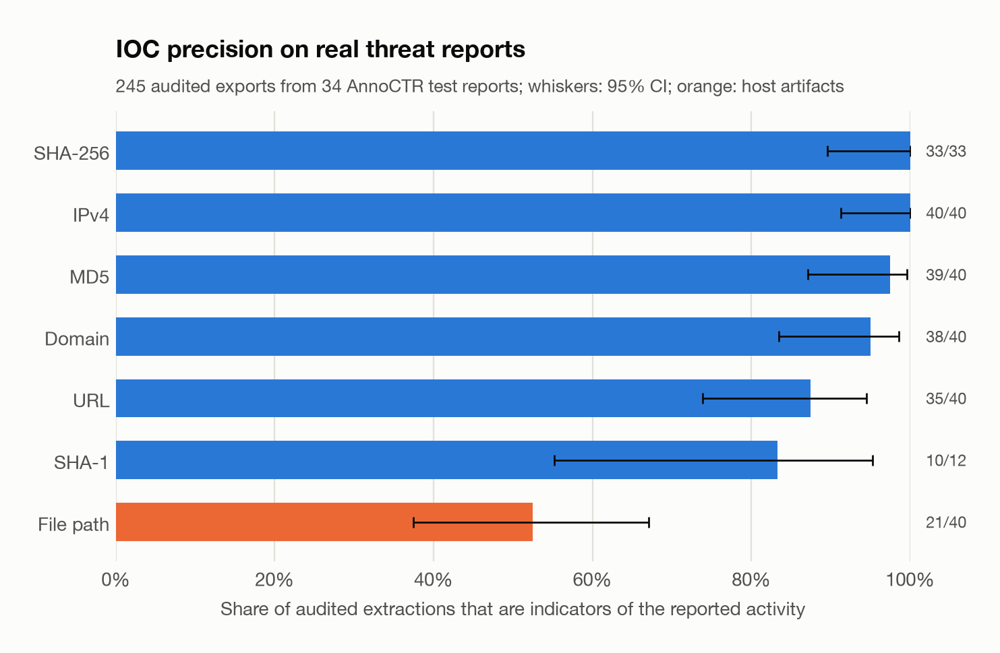
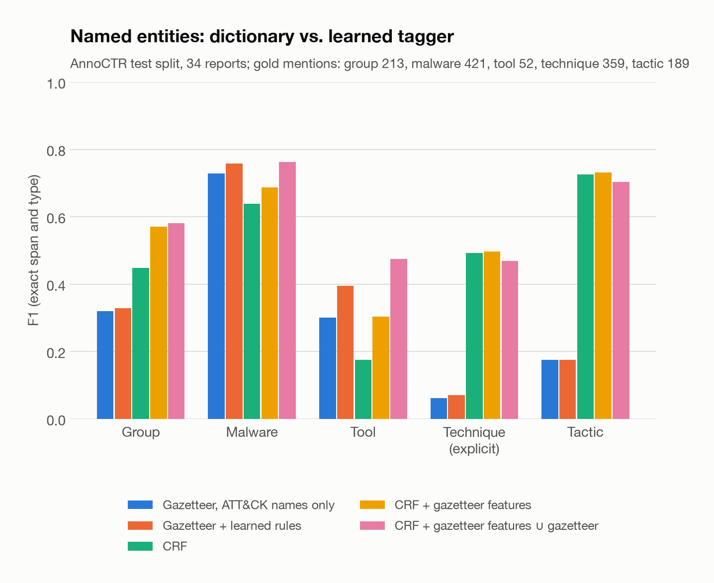
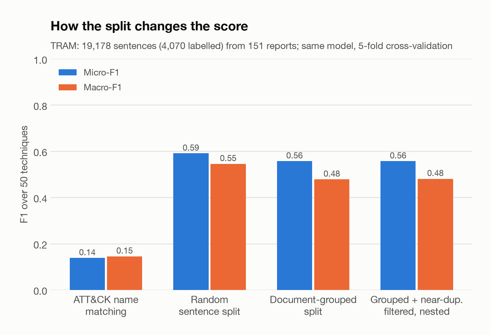
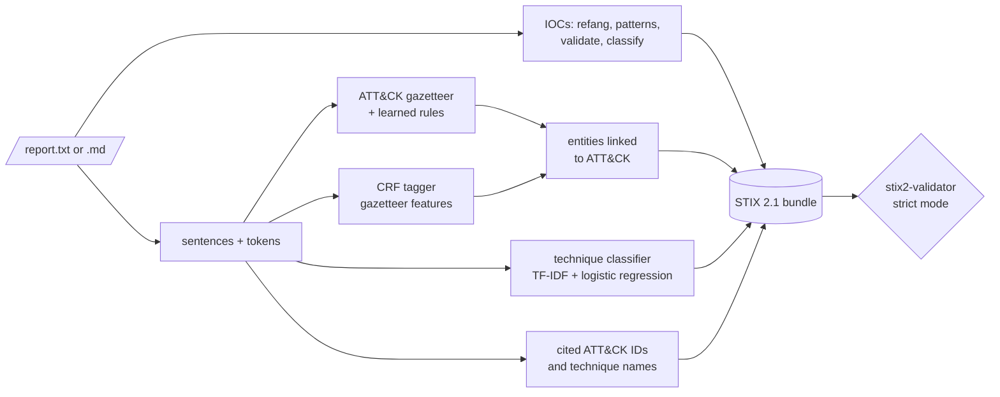

# Gleaner: CTI extraction with NLP → STIX 2.1

[](https://github.com/hugo-kte/cti-to-stix/actions/workflows/ci.yml)

-1f6feb)


Gleaner turns unstructured threat reports into structured, machine-readable intelligence. It
extracts **indicators of compromise** (refanged and validated), **named entities** (threat
actors, malware, tools) linked to MITRE ATT&CK, and the **ATT&CK techniques** a report
describes, then exports everything as a **STIX 2.1 bundle** that passes the OASIS validator in
strict mode. Each step is measured on public, expert-annotated data (MITRE's TRAM, Bosch's
AnnoCTR) with leakage-aware protocols, and the results below include what does not work.

## Results

| Step | Evaluated on | Result |
|---|---|---|
| IOC extraction | 34 real vendor reports (AnnoCTR test split), 389 audit labels from one AI annotator | precision **92.8%** on network indicators and digests (87.9% with host artifacts), estimated recall **94.2%** (optimistic, see protocol) |
| Entities: group, malware, tool, technique, tactic | AnnoCTR test split, 1,234 gold mentions | micro-F1 **0.625** for CRF + gazetteer, vs. 0.416 for the ATT&CK gazetteer alone |
| ATT&CK linking | AnnoCTR malware mentions the annotators linked to ATT&CK | **90.4%** resolved to the right ID, none to a wrong one |
| Technique classification, 50 techniques | TRAM, nested document-grouped cross-validation | micro-F1 **0.557**, macro-F1 **0.481** (a random sentence split would report 0.591 / 0.546) |
| Same model, other corpus | 3,348 AnnoCTR technique mentions | only **26.7%** use one of TRAM's 50 techniques; top-1 correct on 65.0% of those |
| STIX 2.1 export | the 34 AnnoCTR test reports, end to end | **34 / 34** bundles valid in `stix2-validator` strict mode |





More tables, the per-technique scores and the CRF selection grid are in
[`reports/REPORT.md`](reports/REPORT.md); every number comes from
[`reports/metrics.json`](reports/metrics.json).

**What this shows**

1. **Spotting an indicator is easy; deciding that it is one is the work.** Of the 742 values the
   patterns find in the test reports, 366 are classified as citations: vendor blog links,
   screenshots, MITRE pages. A pattern matcher would export all of them; the status rules
   (Markdown link targets, vendor and news sites, live links in a report that defangs its
   indicators) hold them back, and only 1 of 60 audited withheld values was a real indicator.
   What still goes wrong is mostly host artifacts: 19 of 40 audited Windows paths are not
   indicators (generic locations, system binaries such as `C:\Windows\System32\cmd.exe`,
   truncated paths), which is why paths and registry keys are exported with `indicator_types:
   ["unknown"]`.
2. **A dictionary is precise but blind, and the tagger still needs it.** The ATT&CK gazetteer
   finds malware with 0.89 precision, but only 24% of the group mentions in the test split name
   an actor that ATT&CK tracks (59% for malware), which caps its recall. The learned rules lift
   its precision from 0.49 to 0.66 with recall unchanged (0.29 to 0.30). The CRF learns from
   context (0.566 alone), gains 4 points from gazetteer features (0.606), and adding the
   dictionary matches it missed gives the best micro-F1, 0.625.
3. **The split decides the score.** With the same model (word and character TF-IDF, C = 16,
   balanced class weights, threshold 0.3), a random sentence split reports micro-F1 0.591 and
   macro-F1 0.546; holding out whole reports gives 0.558 and 0.479. The gap is widest on
   macro-F1: rare techniques come from a handful of reports, and a random split puts
   near-identical sentences of those reports on both sides. The full protocol (selection inside
   the folds, near-duplicates filtered) gives 0.557 / 0.481; all five folds chose the same
   features, C and class weighting, and the fold-to-fold spread is ±0.019. Matching ATT&CK
   technique names in the text reaches only 0.138: reports describe behaviour, they rarely name
   the technique.
4. **The long tail is the hard part.** Per-technique F1 follows the amount of training data
   (correlation with the log number of labelled sentences: 0.60, see
   [`technique_long_tail.png`](reports/figures/technique_long_tail.png)). The ten most frequent
   techniques average F1 0.56, the nine with fewer than 25 labelled sentences 0.23, and
   T1557.001 and T1072 (7 and 10 sentences) are never found. When a sentence does describe a
   technique, the top-scoring one is right 77.1% of the time.
5. **Models trained on one corpus see a different world in another.** AnnoCTR's 3,348 technique
   mentions cover 149 techniques; only 28 of them, 26.7% of the mentions, are among TRAM's 50,
   so the classifier cannot name the rest. On the mentions it could name, top-1 accuracy is
   65.0% (77.7% for explicit mentions, 60.7% for implicit ones) against 77.1% on TRAM
   ([`cross_dataset.png`](reports/figures/cross_dataset.png)). A sentence classifier trained on
   50 techniques is a strong prior for frequent behaviour, not a map of ATT&CK.

## Example

`gleaner extract examples/glass-heron.md --format md` on a short synthetic report (fictional
actor, documentation-range indicators), with the locally trained CRF; from a fresh clone the
same five entities are found by the gazetteer instead. Full outputs:
[`docs/examples/glass-heron.summary.md`](docs/examples/glass-heron.summary.md) and the STIX
bundle [`docs/examples/glass-heron.stix.json`](docs/examples/glass-heron.stix.json).

```text
Indicators (10): 1 URL, 2 IPv4, 1 e-mail, 3 digests, 1 file path, 1 registry key, 1 CVE
Not exported:    1 benign (8.8.8.8), 1 internal (10.20.30.40), 1 reference (attack.mitre.org)
```

| Type | Name | ATT&CK | Mentions | Found by |
|---|---|---|---:|---|
| malware | QakBot | [S0650](https://attack.mitre.org/software/S0650) | 5 | crf |
| malware | Cobalt Strike | [S0154](https://attack.mitre.org/software/S0154) | 2 | crf |
| tool | AdFind | [S0552](https://attack.mitre.org/software/S0552) | 1 | gazetteer |
| tool | Mimikatz | [S0002](https://attack.mitre.org/software/S0002) | 1 | crf |
| tool | PsExec | [S0029](https://attack.mitre.org/software/S0029) | 1 | crf |

| Technique | Score | Found by | Evidence (truncated) |
|---|---:|---|---|
| T1003.001 LSASS Memory | 1.00 | classifier, name | …dump credentials from LSASS memory with Mimikatz. |
| T1543.003 Windows Service | 1.00 | classifier, name | …creating a temporary Windows service on each target host. |
| T1547.001 Registry Run Keys / Startup Folder | 0.99 | classifier | The loader adds a Run key value under HKCU\…\Run\OneDriveSync… |
| T1190 Exploit Public-Facing Application | 0.98 | classifier | …the group also exploited CVE-2021-44228 to obtain initial access. |
| T1218.011 Rundll32 | 0.97 | classifier | …a shortcut file that launches rundll32.exe to load a QakBot DLL… |

Five more techniques follow (T1566.001, T1204.002, T1053.005, T1105, T1569.002). The fictional
GLASS HERON is missed: it is not in ATT&CK and the CRF does not tag the all-caps name. In the
bundle, the address becomes an indicator that `indicates` the ATT&CK-linked malware:

```json
[
  {
    "type": "indicator",
    "id": "indicator--316e5889-4731-4a9e-960d-ca71cb0017d2",
    "name": "198.51.100.23",
    "indicator_types": ["malicious-activity"],
    "pattern": "[ipv4-addr:value = '198.51.100.23']",
    "pattern_type": "stix"
  },
  {
    "type": "relationship",
    "relationship_type": "indicates",
    "source_ref": "indicator--316e5889-4731-4a9e-960d-ca71cb0017d2",
    "target_ref": "malware--ac6c1fe5-8653-4240-8a2e-730a5e05dbca",
    "description": "Inferred from co-occurrence in the source report."
  },
  {
    "type": "malware",
    "id": "malware--ac6c1fe5-8653-4240-8a2e-730a5e05dbca",
    "name": "QakBot",
    "is_family": true,
    "aliases": ["Pinkslipbot", "QBot", "QuackBot"],
    "external_references": [
      {"source_name": "mitre-attack", "external_id": "S0650", "url": "https://attack.mitre.org/software/S0650"}
    ]
  }
]
```

The same sentence also names Cobalt Strike, so the address `indicates` it too: relationships
are co-occurrence heuristics (see Limitations). The second example,
[`advisory-no-names.txt`](examples/advisory-no-names.txt), names no tool or actor at all; the
classifier still recovers discovery, lateral tool transfer and file deletion from the wording
([output](docs/examples/advisory-no-names.summary.md)).

## How it works



* **IOCs** ([`iocs.py`](src/gleaner/iocs.py)). Refanging (`hxxp`, `[.]`, `(dot)`, `[@]`,
  Markdown escapes) keeps an offset map back to the source. Candidates are validated per type:
  domains against the ICANN public-suffix list, with file-extension TLDs (`.zip`, `.py`, `.sh`)
  accepted only when defanged or inside a URL; addresses by routing scope (private, loopback,
  CGNAT... are withheld; documentation ranges are kept so synthetic reports still produce a full
  bundle); digests need digits *and* letters, a single case, no `0x` prefix and no `key`/
  `license` label before them; `version 1.2.3.4` is not an address. Each value then gets a
  status: `indicator`, `artifact` (Windows path, registry key), `vulnerability` (CVE),
  `reference` (Markdown link target, vendor or news site, or a live URL in a report that defangs
  its indicators), `benign` (`github.com`, dynamic-DNS roots, public resolvers) or `internal`.
* **Entities** ([`gazetteer.py`](src/gleaner/gazetteer.py), [`ner.py`](src/gleaner/ner.py)). The
  gazetteer matches ATT&CK names and aliases (plus `NetwireRAT`, `psexec.exe`, `Lazarus` for
  `Lazarus Group`) under a case-consistency rule, and with three things learned on the training
  split only: which words are common in lower case (`Royal`, `Net`), a blocklist of
  low-precision aliases, and a relabelling of aliases whose annotated type differs from
  ATT&CK's. The CRF (python-crfsuite, hand-crafted features, no pretrained embeddings) is
  trained from scratch on AnnoCTR with the gazetteer's tags as extra features; at inference,
  gazetteer matches fill the spans the CRF left. A linked entity takes ATT&CK's identifier and
  type.
* **Techniques** ([`techniques.py`](src/gleaner/techniques.py)). One logistic regression per
  technique on word and character n-gram TF-IDF, a single probability threshold, trained on
  TRAM's 50 techniques with its unlabelled sentences as negatives. Report-level evidence also
  includes ATT&CK IDs cited in the text (`T1055.012`) and exact technique names. Identifiers
  from older ATT&CK versions follow the revocation chain (`T1574.002` → `T1574.001`).
* **STIX** ([`stix.py`](src/gleaner/stix.py)). `stix2` objects: `indicator` with escaped STIX
  patterns, `malware`/`tool`/`intrusion-set` with ATT&CK external references, `attack-pattern`
  with kill-chain phases, `vulnerability`, a `report`, a `system` identity and a TLP marking
  (STIX 2.1 predefines the TLP 1.0 markings, so `--tlp clear` is exported as TLP:WHITE).
  Relationships are inferred conservatively: one intrusion set in a report `uses` its malware,
  tools and techniques; one malware family `uses` the techniques and is `indicated` by the
  indicators; with several families an indicator only `indicates` those named in its sentence.
  Identifiers are derived from content (UUIDv4 layout), so re-running on the same report gives
  the same object IDs; only the timestamps and the bundle ID change.

## Evaluation protocol

Every component is evaluated on data that played no part in building it, and the test splits
were used once, after the code, rules and hyper-parameters were frozen.

* **IOCs.** None of the datasets annotates indicators, so the extractor was audited on the 34
  AnnoCTR *test* reports (real vendor reports from Intel 471, Lab52, Proofpoint,
  QuoIntelligence, ZScaler and S2 Grupo); its rules were developed on the train and dev reports
  only. One annotator, an AI agent, labelled each sampled value in its context (`ioc`, `benign`,
  `invalid`): up to 40 exported values per type, plus random samples of the values found but
  not exported and of the candidates that deliberately loose patterns match but the extractor
  ignores. Precision is stratified by type; recall is estimated against those two pools, so an
  indicator that no loose pattern catches is not counted.
  [`reports/ioc_audit.csv`](reports/ioc_audit.csv) stores each label against a truncated
  SHA-256 of the value, and `make evaluate` recomputes every figure from it.
* **Entities.** AnnoCTR's official document-level splits (70 / 16 / 34 reports). Gazetteer rules
  come from train; CRF `c1`/`c2` are chosen on dev (grid in
  [`reports/REPORT.md`](reports/REPORT.md)); the final models are refit on train+dev and
  scored once on test. Scores are entity-level, strict (same span and type), micro-averaged over
  the five CTI types; a lenient (overlap) score is reported too.
* **Techniques.** TRAM's 19,178 sentences from 151 reports, unlabelled sentences included as
  negatives. A random sentence split leaks: sentences of one report share phrasing, and one
  advisory appears twice under two titles. Reports sharing at least 20% of their sentences are
  therefore merged into one group (148 groups), the outer loop is a 5-fold `GroupKFold`,
  features (`word` or `word+char` TF-IDF), `C`, class weighting and the threshold are chosen by
  an inner 3-fold grouped CV on the training folds only, and test sentences with a
  near-duplicate in the training folds (character n-gram cosine ≥ 0.9, 705 sentences) are not
  scored. The same fixed model is also scored under a random sentence split and a plain document
  split to measure the leak.
* **Cross-dataset.** The TRAM model is applied to the sentences of AnnoCTR's 3,348 mentions
  linked to an ATT&CK technique (all splits: the model never saw AnnoCTR). Identifiers on both
  sides are mapped to ATT&CK v19.2 through revocations before comparison.
* **STIX.** The full pipeline runs on all 34 AnnoCTR test reports; every bundle goes through
  `stix2-validator` in strict mode (best-practice warnings count as errors; only check 302,
  "external reference URL without hash", is skipped: ATT&CK's own bundle omits those hashes).

## Limitations

* **The gazetteer only knows what ATT&CK knows.** On the AnnoCTR test split, 24% of group
  mentions and 59% of malware mentions name something ATT&CK tracks (as linked by the
  annotators); new actors and families appear every week. The CRF generalises from context but
  is trained on 86 reports.
* **Label conventions differ.** AnnoCTR calls Remcos and Mimikatz malware, ATT&CK files them as
  tools; a tool counts as such in AnnoCTR only when it is used maliciously. The learned rules
  absorb part of this; the STIX export uses ATT&CK's type for linked entities.
* **Annotation gaps count against the models.** Some unannotated mentions (Sodinokibi,
  NetWire...) and AnnoCTR's choice not to annotate ATT&CK mapping tables make the gazetteer's
  precision on explicit technique names (0.13) look worse than it is: inspecting the dev split
  (outside `make evaluate`), 23 of 24 multi-word technique-name matches were not annotated, 15
  of them rows of such tables.
* **TRAM covers 50 of ATT&CK's ~700 techniques and sub-techniques.** Rare techniques are learned
  poorly (average F1 0.23 below 25 labelled sentences), and the other ~650 cannot be predicted
  at all; cited IDs and exact names are the only route to them in Gleaner.
* **Domain shift.** Only 26.7% of AnnoCTR's technique mentions fall within TRAM's label set, and
  accuracy drops on implicit descriptions. TRAM's labels also predate ATT&CK v19: two of its
  techniques were revoked since (`T1562.001` → `T1685`, `T1574.002` → `T1574.001`) and are
  mapped through the revocation chain.
* **The IOC audit has a single annotator, an AI agent.** It labelled each value from the
  surrounding text during development; no second annotator and no human adjudication checked
  the labels, so the audit figures inherit its mistakes. Known failure modes found by the audit
  and left in place (fixing them after looking at the test reports would bias the numbers):
  URLs glued together in table cells, certificate thumbprints typed as file hashes, Markdown
  escapes after a slash (`/\_notes`), broken defangs such as `example.]com`, and generic
  Windows paths (`C:\Windows\System32\cmd.exe`) exported as artifacts. Bare file names are out
  of scope.
* **Relationships are co-occurrence heuristics,** not extracted relations: a report naming two
  families and one C2 address in the same sentence links the address to both.
* **No pretrained language model**, by design (nothing is downloaded but the three datasets). A
  fine-tuned transformer would very likely beat the CRF and the linear classifier; the
  evaluation harness is ready for one. English only.

## Quickstart

```bash
git clone https://github.com/hugo-kte/cti-to-stix.git && cd cti-to-stix
make install && source .venv/bin/activate                     # needs Python 3.11+
gleaner extract examples/glass-heron.md                       # Markdown summary
gleaner extract examples/glass-heron.md -f stix -o bundle.json && gleaner validate bundle.json
gleaner iocs examples/glass-heron.md                          # indicators only, TSV
```

This works out of the box with the committed ATT&CK catalog, gazetteer rules and technique
model (entities then come from the gazetteer alone). The two CRF taggers are not committed:
`make train` rebuilds them from the pinned data (shared, they would be CC BY-SA 4.0 adaptations
of AnnoCTR, like the gazetteer rules):

```bash
make download    # TRAM, ATT&CK v19.2, AnnoCTR at pinned commits, 88 MB, SHA-256 verified
make train       # CRF selection on AnnoCTR dev + technique model selection on TRAM (~25 min)
make evaluate    # every protocol above -> reports/metrics.json, REPORT.md, figures (~1 h)
make test        # 100 tests on fixtures, no dataset or network needed
```

```text
gleaner extract REPORT [-f md|json|stix] [-o OUT] [--tlp clear|green|amber|red] [--models DIR]
gleaner iocs REPORT [--all] [--raw]
gleaner validate BUNDLE
gleaner download | train [--only ner|techniques] | evaluate [--only iocs,entities,techniques,cross,stix]
```

## Project layout

```text
src/gleaner/
├── iocs.py          refanging, candidate patterns, validation, status
├── text.py          tokeniser and sentence splitter with offsets
├── attack.py        ATT&CK catalog from the STIX bundle (aliases, tactics, revocations)
├── gazetteer.py     ATT&CK dictionary matching and rule learning
├── ner.py           CRF features, training and tagging
├── techniques.py    TF-IDF + logistic regression, pickle-free persistence, leakage control
├── pipeline.py      report -> extraction (IOCs, entities, techniques)
├── stix.py          STIX 2.1 export and strict validation
├── render.py        Markdown summary (indicators defanged)
├── datasets.py      pinned downloads, checksums, loaders
├── train.py         model selection and final training
├── evaluate.py      evaluation protocols -> reports/metrics.json
├── audit.py         IOC audit sampling and scoring
└── report.py, plots.py, cli.py
models/              ATT&CK catalog, gazetteer rules, technique model (CRF: local only)
reports/             metrics.json, REPORT.md, ioc_audit.csv, figures/
examples/            two synthetic reports; docs/examples/ holds their outputs
datasets.toml        dataset sources pinned to commits; checksums.sha256 lists every file
tests/               100 tests on a miniature ATT&CK bundle and toy corpora
```

## Data sources and licences

| Dataset | Pinned version | Licence | Used for |
|---|---|---|---|
| [MITRE CTID TRAM](https://github.com/center-for-threat-informed-defense/tram) (`data/tram2-data`) | commit `f29793d` | Apache-2.0 | technique classifier, nested CV |
| [MITRE ATT&CK Enterprise](https://github.com/mitre-attack/attack-stix-data) | v19.2, commit `6cda5ad` | [ATT&CK Terms of Use](https://attack.mitre.org/resources/legal-and-branding/terms-of-use/) | catalog, gazetteer, attack-patterns, ID normalisation |
| [AnnoCTR](https://github.com/boschresearch/anno-ctr-lrec-coling-2024) (`text`, `ner_json`, `linking_mitre_only`) | commit `d510b69` | CC BY-SA 4.0 | CRF training (train+dev), entity evaluation (test), cross-dataset check, IOC audit |

`gleaner download` fetches exactly the files listed in [`checksums.sha256`](checksums.sha256)
from the commits in [`datasets.toml`](datasets.toml) and verifies them; the corpora are never
committed. Files derived from the data and committed here:

* `models/attack-catalog.json`: ATT&CK names, aliases, tactics and revocations, with MITRE's
  copyright designation and licence embedded. © 2026 The MITRE Corporation. This work is
  reproduced and distributed with the permission of The MITRE Corporation. ATT&CK® is a
  registered trademark of The MITRE Corporation.
* `models/gazetteer-rules.json`: lower-case word statistics from TRAM and AnnoCTR train+dev and
  the ATT&CK alias decisions learned on AnnoCTR train+dev (no corpus text). It is an adaptation
  of AnnoCTR, licensed CC BY-SA 4.0; attribution in [`models/README.md`](models/README.md).
* `models/techniques/`: logistic-regression weights learned from TRAM (Apache-2.0).
* `reports/ioc_audit.csv`: audit labels keyed by AnnoCTR document name and hashed value.

The CRF weights (two 3 MB crfsuite files) are not committed: `make train` rebuilds them from
the pinned data, and if shared they would be CC BY-SA 4.0 adaptations of AnnoCTR too. The two
example reports are written for this project.

> MITRE Center for Threat-Informed Defense. *Threat Report ATT&CK Mapper (TRAM)*.
> https://github.com/center-for-threat-informed-defense/tram
>
> The MITRE Corporation. *MITRE ATT&CK®, Enterprise v19.2*. https://attack.mitre.org
>
> Lukas Lange, Marc Müller, Ghazaleh Haratinezhad Torbati, Dragan Milchevski, Patrick Grau,
> Subhash Pujari, Annemarie Friedrich. *AnnoCTR: A Dataset for Detecting and Linking Entities,
> Tactics, and Techniques in Cyber Threat Reports.* LREC-COLING 2024.
> [arXiv:2404.07765](https://arxiv.org/abs/2404.07765)

## Licences

The code is [MIT](LICENSE)-licensed. `models/gazetteer-rules.json` is an adaptation of AnnoCTR
licensed under [CC BY-SA 4.0](https://creativecommons.org/licenses/by-sa/4.0/) (attribution in
[`models/README.md`](models/README.md)); `models/attack-catalog.json` keeps MITRE's copyright
notice and the ATT&CK Terms of Use; the technique model is learned from TRAM (Apache-2.0).
