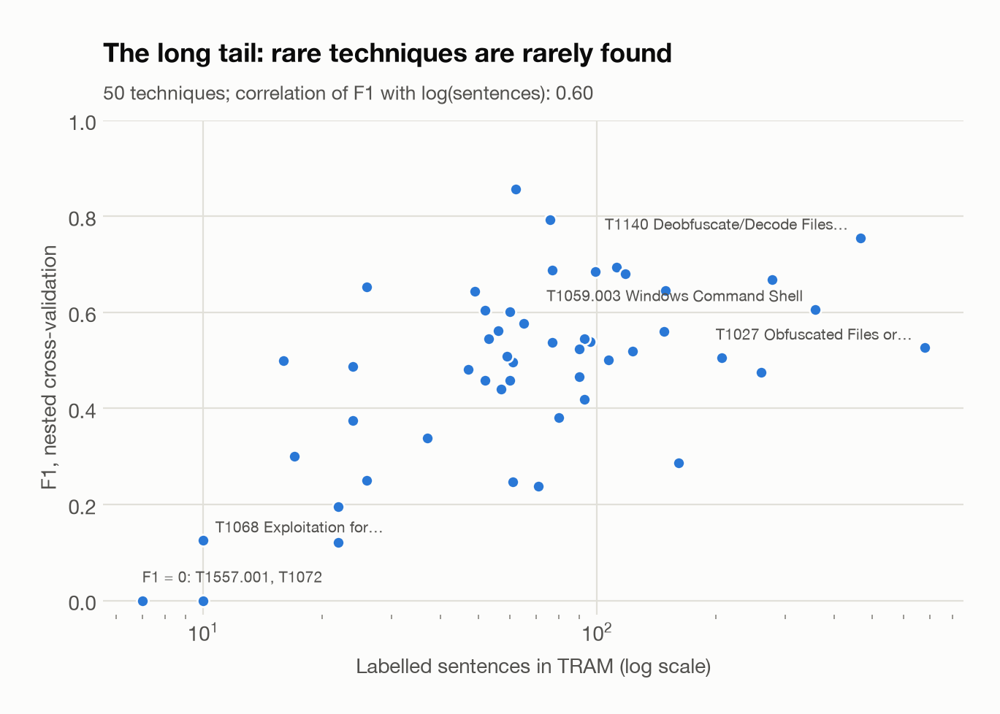
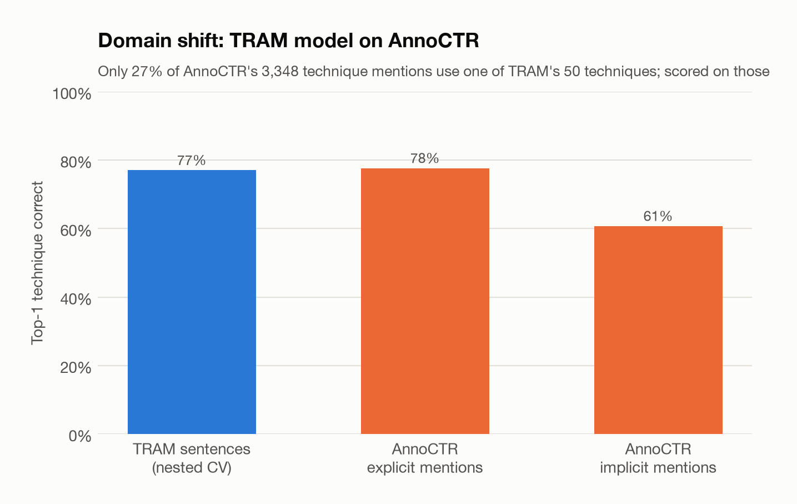

# Gleaner evaluation report

_Generated 2026-10-13T13:31:22+00:00 with Gleaner 0.1.0, MITRE ATT&CK 19.2. All numbers come from `metrics.json`._

## Indicators of compromise

Extraction over the 34 AnnoCTR test reports (17 of them defang at least one indicator).

| Status | Values |
|---|---:|
| reference | 366 |
| indicator | 327 |
| artifact | 43 |
| benign | 4 |
| vulnerability | 2 |

### Manual audit (389 labels)

| Type | Exported | Audited | IOC | Benign | Invalid | Precision | 95% CI |
|---|---:|---:|---:|---:|---:|---:|---|
| URL | 143 | 40 | 35 | 1 | 4 | 87.5% | 73.9%–94.5% |
| Domain | 46 | 40 | 38 | 2 | 0 | 95.0% | 83.5%–98.6% |
| IPv4 | 40 | 40 | 40 | 0 | 0 | 100.0% | 91.2%–100.0% |
| MD5 | 53 | 40 | 39 | 0 | 1 | 97.5% | 87.1%–99.6% |
| SHA-1 | 12 | 12 | 10 | 0 | 2 | 83.3% | 55.2%–95.3% |
| SHA-256 | 33 | 33 | 33 | 0 | 0 | 100.0% | 89.6%–100.0% |
| CVE | 2 | 2 | 2 | 0 | 0 | 100.0% | 34.2%–100.0% |
| File path | 41 | 40 | 21 | 16 | 3 | 52.5% | 37.5%–67.1% |
| Registry key | 2 | 2 | 0 | 0 | 2 | 0.0% | 0.0%–65.8% |

* Precision, stratified by type: **87.9%** overall; network indicators and digests 92.8%, host artifacts 50.1%.
* Withheld values (references, benign, internal): 1/60 audited were missed indicators (population 370).
* Loose-pattern candidates not extracted: 6/80 were missed in-scope indicators, 17 were bare file names (out of scope) (population 185).
* Estimated recall against these pools: **94.2%**.

## Named entities (AnnoCTR test split)

34 reports, 3,059 sentences. Strict entity-level F1 (exact boundaries and type); micro-averaged over the five types.

| System | Group | Malware | Tool | Technique (explicit) | Tactic | Micro P | Micro R | Micro F1 | Lenient micro F1 |
|---|---:|---:|---:|---:|---:|---:|---:|---:|---:|
| gazetteer, names only | 0.319 | 0.729 | 0.301 | 0.061 | 0.175 | 0.492 | 0.291 | **0.366** | 0.514 |
| gazetteer + rules | 0.328 | 0.757 | 0.395 | 0.070 | 0.176 | 0.662 | 0.303 | **0.416** | 0.541 |
| CRF | 0.448 | 0.639 | 0.175 | 0.493 | 0.726 | 0.768 | 0.448 | **0.566** | 0.650 |
| CRF + gazetteer features | 0.571 | 0.687 | 0.303 | 0.497 | 0.732 | 0.782 | 0.494 | **0.606** | 0.700 |
| CRF ∪ gazetteer | 0.571 | 0.760 | 0.481 | 0.468 | 0.703 | 0.723 | 0.547 | **0.623** | 0.728 |
| CRF + gazetteer features ∪ gazetteer | 0.580 | 0.762 | 0.475 | 0.469 | 0.703 | 0.736 | 0.543 | **0.625** | 0.732 |

Gold support: CON 446, MALWARE 421, ORG 372, TECHNIQUE 359, DATE 272, GROUP 213, LOC 189, TACTIC 189, SECTOR 141, TOOL 52, CLICommand/CodeSnippet 39

CRF + gazetteer features on every AnnoCTR type:

| Type | P | R | F1 | Support |
|---|---:|---:|---:|---:|
| CON | 0.763 | 0.614 | 0.681 | 446 |
| MALWARE | 0.869 | 0.568 | 0.687 | 421 |
| ORG | 0.878 | 0.815 | 0.845 | 372 |
| TECHNIQUE | 0.601 | 0.423 | 0.497 | 359 |
| DATE | 0.866 | 0.857 | 0.861 | 272 |
| GROUP | 0.899 | 0.418 | 0.571 | 213 |
| LOC | 0.869 | 0.810 | 0.838 | 189 |
| TACTIC | 0.863 | 0.635 | 0.732 | 189 |
| SECTOR | 0.731 | 0.348 | 0.471 | 141 |
| TOOL | 0.714 | 0.192 | 0.303 | 52 |
| CLICommand/CodeSnippet | 0.387 | 0.308 | 0.343 | 39 |

### ATT&CK coverage and alias linking

| Type | Gold mentions | Linked to ATT&CK by annotators | Linked correctly by the gazetteer | Linked although annotators chose another entry |
|---|---:|---:|---:|---:|
| GROUP | 213 | 52 (24.4%) | 30/52 (57.7%) | 14/161 |
| MALWARE | 421 | 250 (59.4%) | 226/250 (90.4%) | 63/171 |
| TOOL | 52 | 11 (21.2%) | 11/11 (100.0%) | 7/41 |

## ATT&CK technique classification (TRAM)

19,178 sentences (4,070 labelled with at least one of 50 techniques) from 151 reports, merged into 148 document groups. 705 test sentences with a near-duplicate in their training folds were not scored.

| Protocol | Micro P | Micro R | Micro F1 | Macro F1 |
|---|---:|---:|---:|---:|
| ATT&CK name matching (no training) | 0.411 | 0.083 | 0.138 | 0.146 |
| Random sentence split (leaky) | 0.559 | 0.627 | 0.591 | 0.546 |
| Document-grouped split | 0.537 | 0.579 | 0.558 | 0.479 |
| Document-grouped, near-duplicates filtered, nested selection | 0.530 | 0.588 | 0.557 | 0.481 |

Fixed model for the protocol comparison: word+char TF-IDF, C=16.0, class_weight=balanced, threshold 0.3. Nested CV fold std: micro-F1 ±0.019, macro-F1 ±0.019. Top-1 accuracy on labelled sentences: 77.1%.

| Fold | Selected features | C | class_weight | Threshold | Test docs | Dropped near-dups | Micro F1 | Macro F1 |
|---:|---|---:|---|---:|---:|---:|---:|---:|
| 0 | word+char | 16.0 | balanced | 0.3 | 30 | 118 | 0.551 | 0.474 |
| 1 | word+char | 16.0 | balanced | 0.3 | 31 | 158 | 0.530 | 0.481 |
| 2 | word+char | 16.0 | balanced | 0.3 | 31 | 165 | 0.546 | 0.458 |
| 3 | word+char | 16.0 | balanced | 0.25 | 29 | 143 | 0.579 | 0.502 |
| 4 | word+char | 16.0 | balanced | 0.25 | 30 | 121 | 0.578 | 0.509 |

### Per technique (nested CV)

| Technique | Name | Sentences | P | R | F1 |
|---|---|---:|---:|---:|---:|
| T1027 | Obfuscated Files or Information | 678 | 0.539 | 0.515 | 0.526 |
| T1140 | Deobfuscate/Decode Files or Information | 466 | 0.714 | 0.803 | 0.756 |
| T1059.003 | Windows Command Shell | 358 | 0.557 | 0.666 | 0.607 |
| T1055 | Process Injection | 278 | 0.617 | 0.730 | 0.669 |
| T1105 | Ingress Tool Transfer | 261 | 0.421 | 0.548 | 0.476 |
| T1106 | Native API | 207 | 0.446 | 0.585 | 0.506 |
| T1078 | Valid Accounts | 161 | 0.287 | 0.286 | 0.287 |
| T1090 | Proxy | 149 | 0.664 | 0.628 | 0.646 |
| T1071.001 | Web Protocols | 148 | 0.548 | 0.574 | 0.561 |
| T1082 | System Information Discovery | 123 | 0.508 | 0.533 | 0.520 |
| T1053.005 | Scheduled Task | 118 | 0.630 | 0.737 | 0.680 |
| T1003.001 | LSASS Memory | 112 | 0.594 | 0.836 | 0.694 |
| T1112 | Modify Registry | 107 | 0.389 | 0.706 | 0.502 |
| T1021.001 | Remote Desktop Protocol | 99 | 0.618 | 0.768 | 0.685 |
| T1204.002 | Malicious File | 96 | 0.463 | 0.646 | 0.539 |
| T1083 | File and Directory Discovery | 93 | 0.408 | 0.430 | 0.419 |
| T1562.001 → T1685 | Disable or Modify Tools | 93 | 0.514 | 0.581 | 0.545 |
| T1070.004 | File Deletion | 90 | 0.420 | 0.522 | 0.465 |
| T1566.001 | Spearphishing Attachment | 90 | 0.458 | 0.611 | 0.524 |
| T1041 | Exfiltration Over C2 Channel | 80 | 0.373 | 0.388 | 0.380 |
| T1047 | Windows Management Instrumentation | 77 | 0.675 | 0.701 | 0.688 |
| T1057 | Process Discovery | 77 | 0.518 | 0.558 | 0.538 |
| T1574.002 → T1574.001 | DLL | 76 | 0.782 | 0.803 | 0.792 |
| T1036.005 | Match Legitimate Resource Name or Location | 71 | 0.254 | 0.225 | 0.239 |
| T1547.001 | Registry Run Keys / Startup Folder | 65 | 0.532 | 0.631 | 0.577 |
| T1056.001 | Keylogging | 62 | 0.895 | 0.823 | 0.857 |
| T1005 | Data from Local System | 61 | 0.250 | 0.246 | 0.248 |
| T1190 | Exploit Public-Facing Application | 61 | 0.471 | 0.525 | 0.496 |
| T1218.011 | Rundll32 | 60 | 0.518 | 0.717 | 0.601 |
| T1573.001 | Symmetric Cryptography | 60 | 0.423 | 0.500 | 0.458 |
| T1570 | Lateral Tool Transfer | 59 | 0.527 | 0.492 | 0.509 |
| T1095 | Non-Application Layer Protocol | 57 | 0.512 | 0.386 | 0.440 |
| T1219 | Remote Access Tools | 56 | 0.523 | 0.607 | 0.562 |
| T1543.003 | Windows Service | 53 | 0.526 | 0.566 | 0.545 |
| T1016 | System Network Configuration Discovery | 52 | 0.439 | 0.481 | 0.459 |
| T1110 | Brute Force | 52 | 0.593 | 0.615 | 0.604 |
| T1113 | Screen Capture | 49 | 0.561 | 0.755 | 0.643 |
| T1033 | System Owner/User Discovery | 47 | 0.426 | 0.553 | 0.481 |
| T1518.001 | Security Software Discovery | 37 | 0.393 | 0.297 | 0.338 |
| T1074.001 | Local Data Staging | 26 | 0.667 | 0.154 | 0.250 |
| T1548.002 | Bypass User Account Control | 26 | 0.696 | 0.615 | 0.653 |
| T1012 | Query Registry | 24 | 0.375 | 0.375 | 0.375 |
| T1484.001 | Group Policy Modification | 24 | 0.588 | 0.417 | 0.488 |
| T1552.001 | Credentials In Files | 22 | 0.211 | 0.182 | 0.195 |
| T1569.002 | Service Execution | 22 | 0.182 | 0.091 | 0.121 |
| T1210 | Exploitation of Remote Services | 17 | 1.000 | 0.176 | 0.300 |
| T1564.001 | Hidden Files and Directories | 16 | 0.583 | 0.438 | 0.500 |
| T1068 | Exploitation for Privilege Escalation | 10 | 0.167 | 0.100 | 0.125 |
| T1072 | Software Deployment Tools | 10 | 0.000 | 0.000 | 0.000 |
| T1557.001 | Name Resolution Poisoning and SMB Relay | 7 | 0.000 | 0.000 | 0.000 |

## Cross-dataset check: TRAM model on AnnoCTR technique mentions

3,348 AnnoCTR mentions linked to an ATT&CK technique (149 distinct techniques, 28 of them among TRAM's 50). The classifier sees the mention's sentence.

| Mentions | Count | In TRAM's label set | Top-1 | Top-3 | Above threshold | Parent technique top-1 |
|---|---:|---:|---:|---:|---:|---:|
| all | 3348 | 894 (26.7%) | 65.0% | 85.5% | 51.7% | 47.8% |
| explicit | 1084 | 224 (20.7%) | 77.7% | 93.8% | 58.0% | 58.4% |
| implicit | 2264 | 670 (29.6%) | 60.7% | 82.7% | 49.6% | 44.3% |

## STIX 2.1 export, end to end

34/34 bundles valid under `stix2-validator` strict mode (0 errors, 0 warnings); 0.27 s per report with iocs, gazetteer, crf, technique-classifier.

Objects per report: indicator 10.9, relationship 8.8, attack-pattern 8.1, malware 1.6, identity 1.0, marking-definition 1.0, report 1.0, intrusion-set 0.9, tool 0.3, vulnerability 0.1.

## Model selection (AnnoCTR dev)

Each variant keeps the `c1`/`c2` pair with the best dev micro-F1 over all AnnoCTR types (✓); the pipeline uses the variant whose kept pair scores higher on the five CTI types. Both final taggers are then refit on train+dev.

| Variant | c1 | c2 | Dev micro F1, all types | Dev micro F1, CTI types | Kept |
|---|---:|---:|---:|---:|:---:|
| crf | 0.05 | 0.01 | 0.588 | 0.577 |  |
| crf | 0.05 | 0.1 | 0.599 | 0.589 | ✓ |
| crf | 0.2 | 0.01 | 0.579 | 0.576 |  |
| crf | 0.2 | 0.1 | 0.584 | 0.560 |  |
| crf+gazetteer | 0.05 | 0.01 | 0.578 | 0.590 |  |
| crf+gazetteer | 0.05 | 0.1 | 0.596 | 0.612 | ✓ |
| crf+gazetteer | 0.2 | 0.01 | 0.586 | 0.601 |  |
| crf+gazetteer | 0.2 | 0.1 | 0.594 | 0.622 |  |

Pipeline tagger: **crf+gazetteer**.
